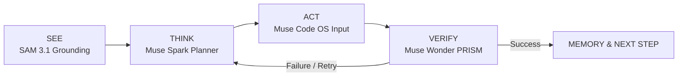

# NoMCP - The Universal Worker - Vision File

## Core Idea
**We kill the need for MCP / API integrations.**
Any legacy or modern software (Tally, Government Tax Portals, SAP, Legacy ERPs, Desktop Apps) can be operated by an AI agent simply by **SEEING** the screen and interacting with mouse and keyboard just like a human operator.

---

## The 5 Meta Models Architecture

| Role | Model | Function in NoMCP |
|---|---|---|
| **Eyes (UI Grounding)** | **SAM 3.1** | Segments buttons, text fields, tables, dropdowns, and active dialogs from raw desktop screenshots. |
| **Brain (Planner)** | **Muse Spark** | High-level goal decomposition into sequential, atomic UI tasks; error recovery strategies. |
| **Supervisor (Verifier)** | **Muse Wonder (PRISM)** | Visual verification before & after each action. Detects errors, popups, and confirms state changes. |
| **Hands (Action Generator)** | **Muse Code** | Synthesizes exact OS input commands (clicks, typing, shortcuts, navigation). |
| **Reporter** | **Muse Image / Multimodal** | Generates visual audit logs, execution summaries, and final task evidence reports. |

---

## Core Execution Loop

1. **SEE (Grounding)**: Capture fresh screen observation -> Ground UI elements into interactive bounding boxes / coordinates.
2. **THINK (Planning)**: Formulate the immediate next atomic step towards the user's objective.
3. **ACT (Execution)**: Dispatch native OS mouse/keyboard actions.
4. **VERIFY (Supervision)**: Inspect post-action visual state to verify expected outcome (e.g., did modal open? did data submit?).
5. **MEMORY**: Retain context across steps and assemble final evidence report.

---

## Form Factor & Packaging
- **Target**: Universal Desktop App (`NoMCP.exe` / native tray app).
- **Core Capabilities**:
  - Global hotkeys (Start / Pause / Takeover / Emergency Stop).
  - Floating status pill & visual grounding overlay.
  - Transparent execution journal & user confirmation gates.

---

## 2-Minute Demo Scenario
- **Input**: Hindi / English voice prompt (*"Tally me invoice create karke Excel summary bana do"*).
- **Execution**: Agent grounds UI on legacy accounting software -> Types entries -> Generates output file.
- **Output**: Verified execution evidence + spreadsheet summary report without touching a single API or MCP connector.
