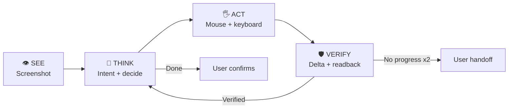

# Ghost Agent — The Universal Worker

> **Meta Global AI Developer Hackathon 2026**  
> **Tagline:** *Zero per-app APIs. Zero MCPs. Zero Connectors. Pure Vision.*

Ghost Agent removes per-app API integrations and MCP servers: instead of connectors, an AI agent **SEEs** the screen and uses mouse and keyboard like a human. The tested demo is a Tally-style voucher-entry fixture on Ubuntu/X11 (see the demo script below); broader app coverage is future work.

---

## 🌟 Agent loop (one Meta model, three roles)



| Role | Implementation | Function in Ghost Agent |
|---|---|---|
| **Observe** | Screenshot capture | Fresh screenshot of the selected desktop before every step. |
| **Think** | Meta model, intent prompt | Goal text becomes structured params; missing values trigger a question, never a guess. |
| **Decide** | Meta model, computer-use prompt | Exactly one next action (click, type, keypress, scroll, wait) per step. |
| **Verify (PRISM)** | Image-change heuristic + OCR/Meta readback | Stall detection on every action; typed values are read back from the screen. Two stagnant steps hand control to the user. |
| **Hands** | OS input driver (X11) | Executes validated clicks, typing, and shortcuts. No reasoning here. |

Optional AT-SPI accessibility grounding is disabled by default; the default screen-only mode returns zero tags. Explicitly enabling it reads UI labels and changes that observation boundary.

---

## ⚡ Key Highlights

1. **🎙️ Multilingual Voice First (Hindi & English):**
   - Speak naturally in Hindi (*"Tally me 50,000 ka invoice generate karo"*) or English.
   - Built-in Web Speech API with microphone status feedback.

2. **👁️ Live Screen Overlay:**
   - Screenshot view with a pulsing target crosshair over the pending action coordinates.
   - Timeline of per-action verdicts; tag counter reads 0 until a real detector is wired (no invented boxes).

3. **🛡️ PRISM Closed-Loop Verification:**
   - Encoded-image stall heuristics plus OCR or model readback of every typed value. Image changes alone never verify text.
   - One retry with a recovery note, then control returns to you instead of looping.

4. **🔒 Protected OS Credential Storage:**
   - Remembers API keys locally using OS native **DPAPI** (Windows) and **Keychain / Secret Service** (Linux/macOS).
   - Remembering is refused when protected storage is unavailable, including Linux basic_text. Use a session-only key instead; no weak encryption fallback is written.

5. **📦 Universal Desktop Packaging:**
   - Built with Electron, React, and TypeScript.
   - Packageable as a standalone Windows executable (`ghost-agent`) and Linux AppImage/tar.gz.

---

## 📸 Photo-to-entry (bill photo → app entry)

1. Attach up to 3 bill photos (PNG/JPEG, ≤8MB each) with the 📎 button, then type the goal ("is bill ki entry Calc me karo").
2. The agent reads the photo (free OCR first, vision fallback), extracts bill no / date / total / item rows, and asks once if values are missing — reply with the values or PROCEED.
3. Extracted values drive the entry field-by-field; every typed value is read back (PRISM) and the final screen is cross-checked against the photo before the run completes.
4. If nothing readable survives, the run fails fast with guidance instead of typing guesses.

Limits: printed bills only (handwriting not supported); mid-run corrections are typed as text answers (re-attaching a photo mid-run is not supported).

---

## 🚀 Quick Start

### Installation & Run
```bash
# 1. Install dependencies (pnpm only — npm install creates a conflicting lockfile)
pnpm install

# 2. Run developer desktop app
npm run dev
```

### Execution and data boundaries

The input driver supports one display in an isolated Ubuntu **X11** session. Wayland, ambiguous display identity, failed geometry/focus checks, and input errors stop dispatch. Windows packaging does not establish Windows input support.

Default operation uses screenshots and mouse/keyboard input. Direct host shell access, accessibility grounding, and task-content retention are on for local development; set any `GHOST_*` flag to `0` to lock it down. Enabled host commands run with the user's file/network privileges and auto-run in autonomous modes (step-by-step still asks). These flags and the isolation checkbox do not create an OS sandbox. Provider safety checks require review even in autonomous mode.

Goals, your text replies, action metadata, and attachment names stay in local history until that chat is deleted. Agent prose, command strings, terminal output, screenshots, photos, and mission context are omitted from default durable history/metadata. Photos are processed in memory. `GHOST_RETAIN_TASK_CONTENT=1` separately opts into task-content/checkpoint/learning retention and restart resume; old saved files remain untouched when this is off. Retained missions/learning have a separate lifecycle from deleting a chat. Never include passwords/secrets in tasks. Journals contain fixed event summaries and counters. Existing legacy records are preserved as-is; these stricter defaults govern new writes. These local controls do not establish provider-side retention or residency guarantees.

### Run the Interactive Tally Demo Simulator
```bash
# Launch the bundled legacy accounting ERP simulator side-by-side:
npm run demo:tally
```

### Complete Test & Quality Suite
```bash
# Typecheck, lint, full unit suite, and production build check
npm run check
```

---

## 📖 Documentation Index

- [Vision File (`Ghost_Vision_For_Agent.md`)](docs/Ghost_Vision_For_Agent.md) — Core philosophy & 5 Meta Models breakdown.
- [2-Minute Pitch & Demo Script (`DEMO_PITCH_SCRIPT.md`)](DEMO_PITCH_SCRIPT.md) — Word-for-word voiceover script and video recording guide.
- [Tally demo script (`demo/legacy-accounting/DEMO_SCRIPT.md`)](demo/legacy-accounting/DEMO_SCRIPT.md) — Frozen task, reset steps, evidence checklist, and shot list.
- [Architecture & Boundaries (`docs/ARCHITECTURE.md`)](docs/ARCHITECTURE.md) — Process isolation, restricted IPC, and security gates.
