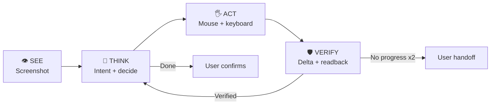

# Ghost Agent — The Universal Worker

> **Meta Global AI Developer Hackathon 2026**  
> **Tagline:** *Zero per-app APIs. Zero MCPs. Zero Connectors. Pure Vision.*

Ghost Agent removes per-app API integrations and MCP servers: instead of connectors, an AI agent **SEEs** the screen and uses mouse and keyboard like a human. The tested demo is a Tally-style voucher-entry fixture on Ubuntu/X11 (see the demo script below); broader app coverage is future work.

---

## 🌟 Agent loop (one Meta model, three roles)



| Role | Implementation | Function in Ghost Agent |
|---|---|---|
| **Observe** | Screenshot capture | Fresh screenshot of the selected desktop before every step. |
| **Think** | Meta model, intent prompt | Goal text becomes structured params; missing values trigger a question, never a guess. |
| **Decide** | Meta model, computer-use prompt | Exactly one next action (click, type, keypress, scroll, wait) per step. |
| **Verify (PRISM)** | Pixel delta + Meta readback prompt | Stall detection on every action; typed values are read back from the screen. Two stagnant steps hand control to the user. |
| **Hands** | OS input driver (X11) | Executes validated clicks, typing, and shortcuts. No reasoning here. |

A UI-tag grounding seam exists for a future detector; it currently returns zero tags rather than guessing boxes.

---

## ⚡ Key Highlights

1. **🎙️ Multilingual Voice First (Hindi & English):**
   - Speak naturally in Hindi (*"Tally me 50,000 ka invoice generate karo"*) or English.
   - Built-in Web Speech API with microphone status feedback.

2. **👁️ Live Screen Overlay:**
   - Screenshot view with a pulsing target crosshair over the pending action coordinates.
   - Timeline of per-action verdicts; tag counter reads 0 until a real detector is wired (no invented boxes).

3. **🛡️ PRISM Closed-Loop Verification:**
   - Pixel-delta stall detection on every action plus model readback of typed values.
   - One retry with a recovery note, then control returns to you instead of looping.

4. **🔒 Hardware-Encrypted Credential Storage:**
   - Remembers API keys locally using OS native **DPAPI** (Windows) and **Keychain / Secret Service** (Linux/macOS).
   - Zero plaintext storage; renderer web code never accesses raw credentials.

5. **📦 Universal Desktop Packaging:**
   - Built with Electron, React, and TypeScript.
   - Packageable as a standalone Windows executable (`ghost-agent`) and Linux AppImage/tar.gz.

---

## 🚀 Quick Start

### Installation & Run
```bash
# 1. Install dependencies (pnpm only — npm install creates a conflicting lockfile)
pnpm install

# 2. Run developer desktop app
npm run dev
```

### Run the Interactive Tally Demo Simulator
```bash
# Launch the bundled legacy accounting ERP simulator side-by-side:
npm run demo:tally
```

### Complete Test & Quality Suite
```bash
# Typecheck, lint, full unit suite, and production build check
npm run check
```

---

## 📖 Documentation Index

- [Vision File (`Ghost_Vision_For_Agent.md`)](docs/Ghost_Vision_For_Agent.md) — Core philosophy & 5 Meta Models breakdown.
- [2-Minute Pitch & Demo Script (`DEMO_PITCH_SCRIPT.md`)](DEMO_PITCH_SCRIPT.md) — Word-for-word voiceover script and video recording guide.
- [Tally demo script (`demo/legacy-accounting/DEMO_SCRIPT.md`)](demo/legacy-accounting/DEMO_SCRIPT.md) — Frozen task, reset steps, evidence checklist, and shot list.
- [Architecture & Boundaries (`docs/ARCHITECTURE.md`)](docs/ARCHITECTURE.md) — Process isolation, restricted IPC, and security gates.
