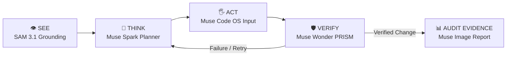

# NoMCP — The Universal Worker

> **Meta Global AI Developer Hackathon 2026**  
> **Tagline:** *Zero APIs. Zero MCPs. Zero Connectors. Pure Vision.*

NoMCP kills the need for per-app API integrations and MCP servers. Any software — from modern browsers to legacy desktop ERPs like Tally and government tax portals — can be operated autonomously by an AI agent simply by **SEEING** the screen and interacting with mouse and keyboard like a human.

---

## 🌟 The 5 Meta Models Architecture



| Role | Meta Model | Function in NoMCP |
|---|---|---|
| **Eyes (UI Grounding)** | **SAM 3.1** | Segments buttons, inputs, tables & dialogs; generates numbered Set-of-Marks tags and center snap points. |
| **Brain (Planner)** | **Muse Spark** | High-level goal decomposition into sequential, atomic UI tasks with error recovery strategies. |
| **Supervisor (Verifier)** | **Muse Wonder (PRISM)** | Closed-loop visual verification before & after each action. Calculates screen deltas and detects popups. |
| **Hands (Action Generator)** | **Muse Code** | Synthesizes exact OS input commands (clicks, typing, shortcuts, navigation). |
| **Reporter** | **Muse Image / Multimodal** | Generates visual audit logs, execution summaries, and final task evidence reports. |

---

## ⚡ Key Highlights

1. **🎙️ Multilingual Voice First (Hindi & English):**
   - Speak naturally in Hindi (*"Tally me 50,000 ka invoice generate karo"*) or English.
   - Built-in Web Speech API with real-time sound wave visualizer.

2. **👁️ SAM 3.1 Visual Grounding Overlay:**
   - Real-time SVG overlay drawing glowing bounding boxes and Set-of-Marks badges `[#1]`, `[#2]`.
   - Laser crosshair targeting reticle pulsing over active action coordinates.

3. **🛡️ Muse Wonder PRISM Closed-Loop Verification:**
   - Replaces fragile open-loop automation with perceptual diff verification.
   - Transparently audits and displays visual screen delta (+18%) for every action.

4. **🔒 Hardware-Encrypted Credential Storage:**
   - Remembers API keys locally using OS native **DPAPI** (Windows) and **Keychain / Secret Service** (Linux/macOS).
   - Zero plaintext storage; renderer web code never accesses raw credentials.

5. **📦 Universal Desktop Packaging:**
   - Built with Electron, React, and TypeScript.
   - Packageable as a standalone Windows executable (`NoMCP.exe`) and Linux AppImage/tar.gz.

---

## 🚀 Quick Start

### Installation & Run
```bash
# 1. Install dependencies
npm ci

# 2. Run developer desktop app
npm run dev
```

### Run the Interactive Tally Demo Simulator
```bash
# Launch the bundled legacy accounting ERP simulator side-by-side:
npm run demo:tally
```

### Complete Test & Quality Suite
```bash
# Typecheck, lint, 121 unit tests, and production build check
npm run check
```

---

## 📖 Documentation Index

- [Vision File (`NoMCP_Vision_For_Agent.md`)](NoMCP_Vision_For_Agent.md) — Core philosophy & 5 Meta Models breakdown.
- [2-Minute Pitch & Demo Script (`DEMO_PITCH_SCRIPT.md`)](DEMO_PITCH_SCRIPT.md) — Word-for-word voiceover script and video recording guide.
- [Architecture & Boundaries (`docs/ARCHITECTURE.md`)](docs/ARCHITECTURE.md) — Process isolation, restricted IPC, and security gates.
