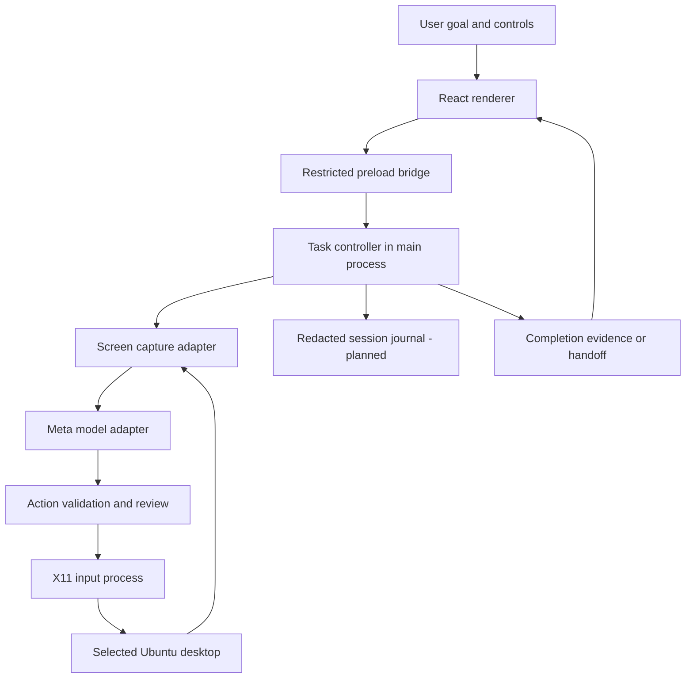

# Proposed architecture

Status: source includes the shell, restricted IPC, task controller, Meta adapter, session connection setup, user handoff, floating controls, and single-display Ubuntu/X11 capture/input adapter. Live integration is unverified; the complete requirements below remain acceptance targets. Updated 2026-10-30. See [development](DEVELOPMENT.md) for the actual tree and validation record.

## System shape

One Electron desktop application coordinates one controlled desktop session and a Meta model provider. No hosted Ghost Agent backend, database, queue service, or per-app integration is required for the initial proposal. That keeps the first implementation small while preserving clear internal boundaries.

The React renderer is the interface inside the installed application, not a public browser website. Vite's development server is a development tool; a packaged build loads local bundled UI assets. Only the privileged Electron side can invoke desktop adapters, through explicitly validated requests.



The first input adapter uses an asynchronous external xdotool process with a timeout and abort signal rather than a native Node worker. This keeps blocking input work outside the main event loop. A future native library would still need worker isolation. Cancellation cannot reverse input already sent to the desktop; one-second Stop acceptance remains unverified.

## Components and ownership

| Component | Owns | Boundary |
| --- | --- | --- |
| Renderer | Goal entry, progress, settings, review, results | No raw OS access or retained-key retrieval; new key entry is transient and cleared after submission |
| Preload bridge | Named, typed IPC operations | Validate sender and payload; no generic command executor |
| Task controller | Run lifecycle, limits, cancellation, coordination | Single source of run state; one desktop owner |
| Capture adapter | Approved display, fresh image, geometry metadata | Confirms permission and display identity before capture |
| Model adapter | API requests, response parsing, usage metadata | Translates provider responses into internal actions; never executes them |
| Action gate | Schema, bounds, scope, state, review decisions | Rejects invalid or stale actions before dispatch |
| Desktop driver | Mouse and keyboard events | Executes the accepted action only; no reasoning or task planning |
| Journal | Redacted events and measurements | Excludes secrets and raw typed content by default |
| Completion checker | Task-specific evidence condition | A model's final message alone is insufficient proof |

## Logical source layout

These top-level directories exist. Agent and Meta provider modules are implemented in source; persistent observability and live desktop tests remain placeholders. The detailed tree and import rules are in [development](DEVELOPMENT.md).

```text
src/
  main/                 Electron lifecycle, windows, IPC, credential access
  preload/              Narrow typed bridge
  renderer/             Goal, progress, review, and result UI
  agent/                Task controller, run states, limits, verification
  providers/meta/       Meta requests and response translation
  desktop/              Capture, geometry, input worker, session capabilities
  policy/               Action checks and approval decisions
  shared/               Action and event schemas, safe shared types
  observability/        Redacted run journal and metrics
```

## Execution loop

- [ ] **ARCH-001** Admit a task only after preflight, desktop selection, cloud disclosure, and run limits are established. Assign a run ID and exclusive desktop ownership.
- [ ] **ARCH-002** Observe the chosen display and assign an observation ID. Include capture time, image size, desktop geometry, and scale mapping so coordinate interpretation is explicit.
- [ ] **ARCH-003** Ask the model for the next action or a small independent batch using the goal and current observation. Keep provider-specific payloads inside the model adapter.
- [ ] **ARCH-004** Validate actions and bind them to the active run and observation. Invalidate pending actions after pause, stop, display changes, a user takeover, or unexpected UI transitions.
- [ ] **ARCH-005** Execute accepted input serially, then capture again. Do not run a long precomputed plan across screens that may change.
- [ ] **ARCH-006** Continue, recover, request input, or finish according to observed results and remaining limits. Save the terminal state and completion evidence reference.

The provider contract should follow [Meta's computer-use documentation](https://dev.meta.ai/docs/computer-use). The internal lifecycle and validation rules above are Ghost Agent design requirements, not claims that the provider implements them for us.

## Run states

```text
idle -> preparing -> observing -> thinking -> awaiting_approval -> acting -> observing
                                     |
                                     +-> verifying -> completed / failed after user review

Any active state -> paused | needs_user | stopped | failed
paused / needs_user -> observing after explicit resume
completed / stopped / failed -> terminal; a new task gets a new run ID
```

The current build requires user review of the final result; marking it incomplete ends the run as failed. A stopped run never resumes or accepts late provider results. The model can request verification/login/clarification handoff through request_user_help, and the user can choose Take control. The needs_user state clears the screenshot, cancels outstanding work, and invalidates approvals. New work stays paused until explicit resume and a fresh screen observation; the five-minute deadline still applies. Reliable live challenge recognition and automatic semantic completion verification remain unverified.

## Contract requirements

| Record | Required information | Validation |
| --- | --- | --- |
| Task | Run ID, goal, desktop selection, allowed scope, limits | Complete before execution starts |
| Observation | Run/observation IDs, timestamp, display geometry, image dimensions | Fresh enough for the next action; matching selected display |
| Action | Action ID, run/observation IDs, allowed type, validated arguments | Numeric finite coordinates, bounded text, valid keys/buttons, no unknown fields |
| Review decision | Action ID, decision, scope, expiry/state | One decision cannot authorize unrelated future actions |
| Outcome | State, visible evidence reference, remaining work, reason | Completed requires the task's defined success condition |
| Journal event | Correlation IDs, time, stage, outcome, duration, usage if available | No raw screenshot bytes, keys, passwords, or unrestricted text |

## Failure behavior

- [ ] **ARCH-007** Cancel model work and discard queued actions on Stop. Ignore all late completions for the old run ID; never infer a successful rollback.
- [ ] **ARCH-008** Handle API timeout/rate limits with bounded request retry and cancellation. Action side effects are not retryable by default; observe before deciding what happened.
- [ ] **ARCH-009** Stop safely on revoked capture permissions, input-worker failure, invalid model output, uncertain target geometry, exhausted limits, or loss of the selected surface.
- [ ] **ARCH-010** Detect repeated lack of progress using repeated observations and action history; ask for help or stop after a finite retry allowance.
- [ ] **ARCH-011** On application restart, show an interrupted task as interrupted. Do not automatically replay its actions.
- [ ] **ARCH-012** Keep status and controls visible while excluding or avoiding the overlay in task observations. Test that the agent does not click its own approval controls.

## Trust and data flow

Renderer isolation, restrictive IPC, locally packaged UI, and a restricted content policy follow the [Electron security guidance](https://www.electronjs.org/docs/latest/tutorial/security). These protect the app boundary; they do not make the model's actions inherently safe.

Goal text and selected screenshots are transmitted to the chosen Meta endpoint over HTTPS. The proposed default is session-only image handling with redacted local metadata. Confirm provider-side retention separately before claiming any retention guarantee. User-entered secrets and credential screens must not be captured or journaled.

The native driver may call operating-system interfaces to deliver input. Target-task content is read through images and operated through the visible UI. In particular, typing into a terminal remains a computer-use action; silently reading the filesystem or calling a target app's API would change the advertised execution mode.

The MVP must use a disposable desktop because an input driver can potentially reach more than one application. A prompt, a selected display, or an app allowlist does not constitute operating-system isolation. No broad accessibility or shell access should be added as an undisclosed fallback.

The task and floating-control windows have separate sandboxed preloads and trusted-sender checks. Only the task window can configure/test a key, start tasks, approve actions, or see screenshots. Floating controls receive minimal state and can pause/resume/stop a matching run or reopen the task window. New keys stay in main-process memory only; no plaintext credential persistence or safeStorage fallback was introduced.

## Future boundaries

SAM can be evaluated behind the observation interface and local inference behind the model interface. Neither experiment should require changing task lifecycle or renderer permissions. Add persistent storage, remote agents, or multiple desktops only when a later requirement justifies them.
